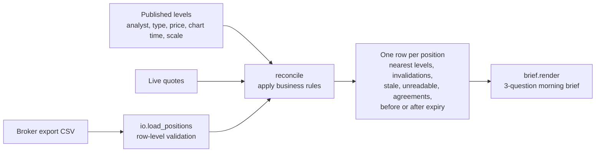

# WaveDesk

**An information-overload tool for traders: WaveDesk reconciles hundreds of daily Elliott Wave analyst posts against one person's holdings, and tells them only what changed for their own positions.**


## The problem

Elliott Wave communities publish analysis all day: on a normal day one community produces well over 200 posts, more than 100 annotated charts and several hours of video. **About 44% of charts carry no written explanation at all**, only a ticker and price levels drawn on the chart. Keyword search and keyword alerts miss them entirely. Nobody can read it all, and the few items that matter to one person (a level redrawn on a stock they own, a watch-list name reaching the price they were waiting for) are scattered thinly through everything else.

WaveDesk is not a trading signal. It does not count waves or recommend trades. It makes sure **nothing an analyst has already said about your own money goes unread**, and it keeps the analyst's words clearly separate from anything the system adds.

## What it produces

A morning brief that answers the three questions an active trader actually has:

```text
# WaveDesk brief, Fri Oct 23 2026, 07:00 ET

## 1. Anything on what I already own?
- HIMS 20 call Jan 2028 at 26.35 live as of 07:00 ET
  - nearest target 34.50 (target, Analyst A) is above break-even 26.85
  - target timing after expiry: 41.00 (target, Analyst B)
- NVDA at 147.20 live as of 07:00 ET
  - price is below 148.00 (invalidation, Analyst B)
  - 1 stale level(s) labelled, not shown as current
  - 1 unreadable level(s) sent to review

## 2. Anything on my watch list?
- SHOP at 150.90 live as of 07:00 ET is within 2% of 148.20 (support, Analyst B)

## 3. Where do analysts agree?
- AMZN: Analyst C 238.00 and Analyst A 236.10 are within 1% (both target/target, fresh charts)
```

All data in this repository is sample data. Analysts are anonymised as A, B and C.

## Quick start

```bash
git clone https://github.com/aryankuckreja/wavedesk.git && cd wavedesk
PYTHONPATH=src python3 -m wavedesk data/positions.csv data/levels.json data/quotes.json --now 2026-10-23T07:00
PYTHONPATH=src python3 -m unittest discover -s tests -v
```

No third-party dependencies. The sample `positions.csv` includes one deliberately bad row (an option without a strike) to show that imports report errors for correction instead of failing or dropping them silently.

## How it works



| Module | Responsibility |
|---|---|
| `models.py` | Positions (shares and options with break-even), levels, live quotes, dashboard rows |
| `rules.py` | The business rules as small, tested functions |
| `reconcile.py` | Matches levels to positions and builds each dashboard row |
| `brief.py` | Renders the morning brief; reports, never recommends |
| `io.py` | CSV and JSON loading with row-level error reporting |

## Requirements engineering

WaveDesk started as my own problem and became my individual project for SE 3352 (Software Requirements and Analysis) at Western. The full requirements process is documented in [`docs/`](docs/):

- **Elicitation** from a client interview (an experienced retail trader who has used Elliott Wave analysis for years), five similar systems (ElliottWaveTrader, TradingView, Seeking Alpha, WaveBasis, MotiveWave), a one-week analysis of real posts, and defect notes from an early prototype.
- **[18 requirements](docs/requirements.md)** (13 functional, 5 non-functional) consolidated from 28 statements, prioritised with MoSCoW and traced back to their sources.
- **[13 business rules](docs/business-rules.md)**, most of them learned from real defects, each with a testable number.
- **[Models and prototyping](docs/design.md):** domain, workflow, data and UI models, 16 user stories in 4 epics managed in Jira and Confluence, and three competing storyboarded prototypes.

The rule that shapes everything: in Canada, advice tailored to a specific person requires registration (NI 31-103, s. 8.25). WaveDesk is designed to **report** what analysts published, credited to each analyst, and leave every decision with the user.

## Roadmap

- [x] Reconciliation core, business rules and morning brief
- [x] CSV import with row-level errors
- [ ] Level change history and change alerts (FR10)
- [ ] Quiet hours and urgent invalidation alerts (FR9, FR11, BR1)
- [ ] Chart image level extraction with an admin review queue (FR5, BR9)
- [ ] Multi-user support with private portfolios (NFR3)
- [ ] Web dashboard (prototype candidate A)

## Disclaimer

WaveDesk reports analysis exactly as published and does not provide investment advice.

## How this was built

The problem, the elicitation and the requirements work are mine (SE 3352). I use Claude as a working part of my development process, and the Python prototype was built with Claude under my direction; I set the business rules and tests it had to meet and reviewed every change.
