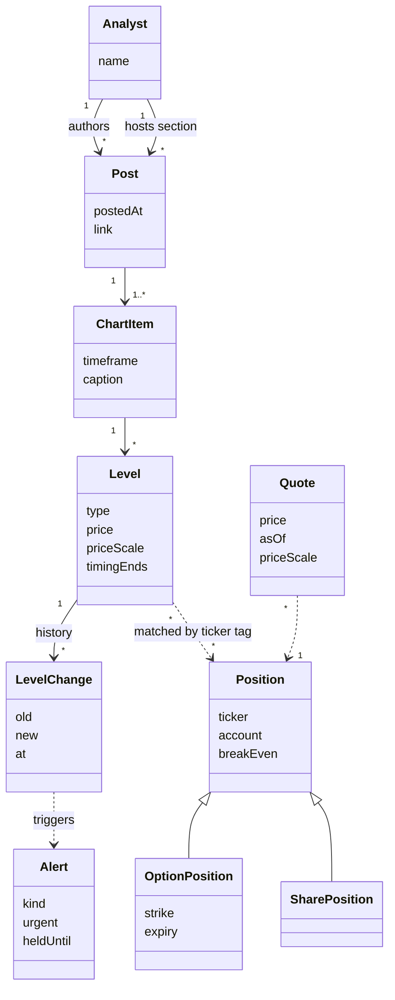
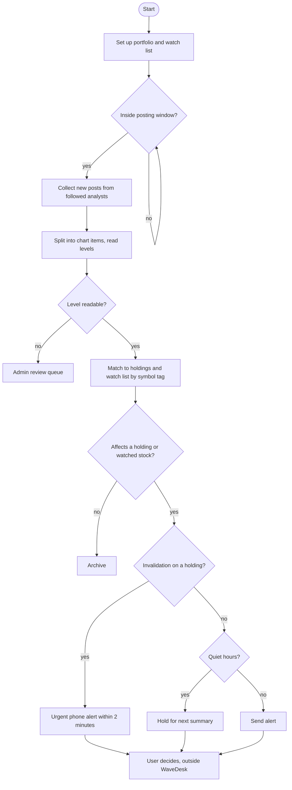

# Analysis and design

## Users and epics

| User | Needs most |
|---|---|
| Options trader (the client) | Expiry dates, invalidation alerts within minutes, targets reachable in time |
| Share investor | Easy setup, nearest levels for adding or taking profit, knowing when a level changes |
| Administrator | Collecting every chart, keeping levels accurate, crediting the right analyst |

16 user stories across 4 epics: **E1 Portfolio setup** (US1, US7, US8), **E2 Analysis collection and accuracy** (US11 to US16), **E3 Alerts and summaries** (US3, US5, US6, US10), **E4 Position review** (US2, US4, US9). Every story has a single-check definition of done, for example "a post with four charts produces four chart items that share the caption".

## Data model (simplified)

Two modelling choices came straight from elicitation: the **author** of a post and the **host** of the section it appears in are separate links, which lets guest posts be credited correctly; and a **chart-time price is a different type from a live quote**, which makes it impossible to show an old price as current.

## Workflow (Level 1)

## Prototyping

Three deliberately different throw-away candidates were storyboarded, each covering all 16 stories:

| Candidate | Idea | Strength | Weakness |
|---|---|---|---|
| A: Desktop dashboard | Sit down and review each morning | Full context for every position | Not with the user during the day |
| B: Mobile app | Glance on the go, swipe through updates | Fits short checks between other things | Small screen for multi-analyst charts |
| C: Messages only | Texts, chat and an email digest, no trader UI | Zero new habits | Hard to see levels side by side |

The prototype in this repository implements the shared core that all three candidates need: reconciliation and the morning brief.
